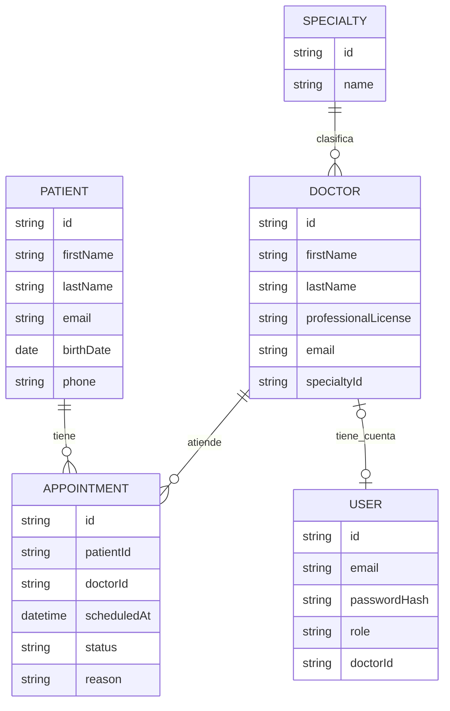

from pathlib import Path

content = r'''# Modelo Entidad-Relación (MER)

<!--
DOCUMENTO: docs/03.0_diagram-er.md

FUNCIÓN: Documentar el diseño conceptual de la base de datos mediante un modelo entidad-relación.

IMPORTANCIA: Visualizar entidades, atributos, relaciones y cardinalidades antes de diseñar el modelo relacional.

FUENTES: Requerimientos, reglas de negocio y documento de entidades y atributos.

METODOLOGÍA: Preparación, identificación de relaciones, definición de cardinalidades, representación y validación.

IMPORTANTE: Este documento describe el modelo conceptual. Las claves y restricciones físicas se formalizan en el modelo relacional y el esquema Prisma.
-->

## Conceptos fundamentales

- **Entidad:** elemento del negocio que necesita representarse.
- **Atributo:** característica que describe una entidad.
- **Relación:** asociación entre dos o más entidades.
- **Cardinalidad:** cantidad máxima de instancias que pueden relacionarse.
- **Participación:** indica la cantidad mínima de instancias que deben participar en una relación.
- **Identificador:** atributo o conjunto de atributos que distingue una instancia.
- **Entidad asociativa:** representa una asociación entre entidades y puede incorporar atributos propios.
- **Entidad dependiente:** su existencia o identificación depende de otra entidad.

## 1. Preparación del modelo

**Fuentes:**

- `00.0_requirements.md`
- `01.0_business-rules.md`
- `02.0_entities-and-attributes.md`
- Esquema Prisma implementado, utilizado para contrastar el modelo documentado con la estructura real.

### 1.1 Entidades que formarán parte del modelo

| ID | Entidad | Descripción | Documento de origen |
|---|---|---|---|
| ENT-001 | Patient | Representa a las personas que reciben atención y pueden tener citas registradas en la clínica. | 02.0_entities-and-attributes.md |
| ENT-002 | Doctor | Representa a los profesionales médicos que atienden pacientes y tienen una especialidad asignada. | 02.0_entities-and-attributes.md |
| ENT-003 | Specialty | Representa las especialidades médicas disponibles y permite clasificar a los médicos. | 02.0_entities-and-attributes.md |
| ENT-004 | Appointment | Representa una cita asociada a un paciente y un médico, con fecha de inicio y estado. | 02.0_entities-and-attributes.md |
| ENT-005 | User | Representa las cuentas que permiten autenticarse y acceder a funciones según su rol. | 02.0_entities-and-attributes.md |

### 1.2 Consideraciones del modelo

El modelo conceptual contempla cinco entidades identificadas en los requerimientos y presentes en el esquema de datos de esta versión.

1. **Patient:** representa a cada paciente registrado. Puede existir sin tener citas.
2. **Doctor:** representa a cada médico registrado y está asociado a una especialidad.
3. **Specialty:** representa el catálogo de especialidades. Puede existir sin médicos asociados.
4. **Appointment:** representa una cita entre un paciente y un médico. Tiene atributos propios y funciona como entidad asociativa.
5. **User:** representa las cuentas de acceso. Puede estar vinculada opcionalmente con un registro Doctor mediante `doctorId`.

**Decisiones conceptuales importantes:**

- Las cinco entidades utilizan un identificador `id`.
- Los identificadores naturales y sus restricciones de unicidad se documentan en el modelo de atributos y en el esquema implementado.
- Appointment representa la asociación entre Patient y Doctor. No se modela una relación directa adicional entre ambas entidades.
- La cita tiene un atributo de fecha y hora de inicio. En Prisma se denomina `scheduledAt` y se mapea a la columna `startAt` en PostgreSQL.
- No se documenta una duración fija ni un atributo de hora de finalización, porque no forman parte de las reglas implementadas confirmadas.
- Los estados de Appointment son `PROGRAMADA`, `COMPLETADA` y `CANCELADA`.
- User dispone de los roles `RECEPCIONISTA`, `MEDICO` y `GERENCIA`.
- `User.doctorId` es opcional y único cuando tiene valor. La obligatoriedad condicional de esta relación según el rol debe distinguirse de la restricción física de nulabilidad del esquema.
- No se incorporan entidades para pagos, facturación, horarios laborales, expedientes clínicos detallados, recetas, inventario o nómina.

La forma de provisionar la cuenta inicial de GERENCIA no agrega una entidad al modelo. Los detalles de inicialización pertenecen a la configuración de la aplicación.

## 2. Identificación de relaciones

**Preguntas de apoyo:**

- ¿Qué entidades se relacionan?
- ¿Qué significa la relación?
- ¿Cuántas instancias pueden participar?
- ¿La relación es obligatoria u opcional?
- ¿Necesita almacenar información propia?
- ¿Qué reglas y restricciones del esquema justifican la relación?

### 2.1 Inventario de relaciones

| ID | Entidad A | Relación (verbo) | Entidad B | Descripción | Referencia |
|---|---|---|---|---|---|
| REL-001 | Specialty | clasifica | Doctor | Una especialidad puede estar asociada con varios médicos; cada médico referencia una especialidad. | Modelo de entidades y esquema Prisma |
| REL-002 | Patient | tiene | Appointment | Un paciente puede tener varias citas y cada cita referencia un paciente. | Modelo de entidades y esquema Prisma |
| REL-003 | Doctor | atiende | Appointment | Un médico puede tener varias citas y cada cita referencia un médico. | Modelo de entidades y esquema Prisma |
| REL-004 | Doctor | tiene asociada | User | Un médico puede estar vinculado con, como máximo, una cuenta; una cuenta puede tener, como máximo, un médico asociado. | `User.doctorId` opcional y único |

**Justificación de las relaciones:**

- **REL-001:** permite clasificar médicos por especialidad y realizar consultas o reportes agrupados.
- **REL-002:** permite consultar las citas asociadas a un paciente.
- **REL-003:** permite consultar la agenda de un médico y asociar las citas con el profesional correspondiente.
- **REL-004:** permite vincular una cuenta de usuario con un registro profesional. La asociación está representada por `User.doctorId`.

La existencia de una restricción en el esquema no demuestra por sí sola todas las reglas condicionales de negocio. En particular, la obligatoriedad de `doctorId` para una cuenta con rol `MEDICO` debe verificarse en la lógica de aplicación y no inferirse únicamente de la nulabilidad de la columna.

## 3. Definición de cardinalidades y participación

### 3.1 Tipos de cardinalidad

- **Uno a uno (1:1):** una instancia de A puede relacionarse con una de B y viceversa.
- **Uno a muchos (1:N):** una instancia de A puede relacionarse con varias de B, pero cada B se relaciona como máximo con una A.
- **Muchos a muchos (N:M):** varias instancias de A pueden relacionarse con varias instancias de B.

### 3.2 Matriz de cardinalidades

| Relación | Entidad A | Entidad B | Cardinalidad | Justificación |
|---|---|---|---|---|
| REL-001 | Specialty | Doctor | 1:N | Una especialidad puede estar asociada con varios médicos. Cada médico referencia una especialidad. |
| REL-002 | Patient | Appointment | 1:N | Un paciente puede tener múltiples citas. Cada cita referencia un único paciente. |
| REL-003 | Doctor | Appointment | 1:N | Un médico puede tener múltiples citas. Cada cita referencia un único médico. |
| REL-004 | Doctor | User | 0..1 : 0..1 | `User.doctorId` es opcional y único; por ello, cada extremo admite como máximo una asociación. |

**Análisis de ambos sentidos:**

- Specialty → Doctor: una especialidad puede estar asociada con varios médicos.
- Doctor → Specialty: cada médico referencia una especialidad.
- Patient → Appointment: un paciente puede tener varias citas o ninguna.
- Appointment → Patient: cada cita referencia un paciente.
- Doctor → Appointment: un médico puede tener varias citas o ninguna.
- Appointment → Doctor: cada cita referencia un médico.
- Doctor → User: un médico puede no tener cuenta o tener como máximo una.
- User → Doctor: una cuenta puede no tener médico asociado o tener como máximo uno.

### 3.3 Participación obligatoria u opcional

**Límites de participación:**

- `0..1`: cero o una instancia.
- `1..1`: exactamente una instancia.
- `0..N`: cero o muchas instancias.
- `1..N`: una o muchas instancias.

| Relación | Entidad | Mínimo | Máximo | Participación | Justificación |
|---|---|---:|---:|---|---|
| REL-001 | Specialty | 0 | N | Opcional | Una especialidad puede existir antes de que se asocien médicos. |
| REL-001 | Doctor | 1 | 1 | Obligatoria | Cada médico referencia una especialidad existente. |
| REL-002 | Patient | 0 | N | Opcional | Un paciente puede registrarse sin citas. |
| REL-002 | Appointment | 1 | 1 | Obligatoria | Cada cita referencia un paciente. |
| REL-003 | Doctor | 0 | N | Opcional | Un médico puede existir sin citas. |
| REL-003 | Appointment | 1 | 1 | Obligatoria | Cada cita referencia un médico. |
| REL-004 | Doctor | 0 | 1 | Opcional | Un médico puede no tener cuenta o tener como máximo una. |
| REL-004 | User | 0 | 1 | Opcional en el esquema | `doctorId` admite nulo y tiene restricción de unicidad. |

**Aclaración sobre User–Doctor:**

La relación física permite que `User.doctorId` sea nulo y limita a una cuenta por registro Doctor. La regla de que una cuenta con rol `MEDICO` deba tener un `doctorId` asociado es una condición de aplicación; no debe representarse como una obligatoriedad garantizada por la columna nullable. Del mismo modo, no se debe afirmar que los roles `RECEPCIONISTA` y `GERENCIA` necesariamente tienen `doctorId` nulo sin verificar esa validación en todos los flujos de escritura.

## 4. Tratamiento de relaciones muchos a muchos

**Ejemplo conceptual:**

Un estudiante puede inscribirse en varios cursos y un curso puede tener varios estudiantes. La relación puede representarse mediante una entidad asociativa `Enrollment` si la inscripción requiere información propia.

### 4.1 Relaciones N:M identificadas

| Relación original | Entidad A | Entidad B | ¿Entidad asociativa conceptual? | Justificación |
|---|---|---|---|---|
| Patient–Doctor, a través de las citas | Patient | Doctor | Sí, Appointment | Un paciente puede tener citas con distintos médicos y un médico puede tener citas con distintos pacientes. Appointment registra la asociación y sus atributos propios. |

### 4.2 Justificación de entidades asociativas

**Appointment como entidad asociativa**

Appointment representa la asociación entre Patient y Doctor dentro del proceso de programación de citas.

La entidad tiene información propia:

- `id`: identifica cada cita.
- `patientId`: referencia al paciente.
- `doctorId`: referencia al médico.
- `scheduledAt`: fecha y hora de inicio en el modelo Prisma; se mapea a `startAt` en PostgreSQL.
- `status`: estado de la cita (`PROGRAMADA`, `COMPLETADA` o `CANCELADA`).
- `reason`: motivo opcional de la cita.

Appointment permite consultar las citas por paciente y por médico, así como aplicar los filtros y reportes implementados.

No se documentan como reglas implementadas la duración fija de 30 minutos, el cálculo de una hora de finalización ni la prevención de traslapes. Esas capacidades no deben deducirse del hecho de que Appointment sea una entidad asociativa.

### 4.3 Consideraciones para el modelo relacional

En el modelo relacional:

1. Appointment conserva su propia identidad mediante un identificador.
2. Representa la asociación con Patient y Doctor mediante referencias a los registros correspondientes.
3. Las referencias garantizan la integridad referencial de las asociaciones.
4. Patient–Doctor no requiere una tabla N:M adicional independiente, porque Appointment representa esa asociación.
5. Las reglas de negocio adicionales sobre disponibilidad o traslapes solo deben incorporarse si se especifican e implementan expresamente.

La relación Doctor–Specialty conserva la referencia obligatoria de cada médico a una especialidad.

La relación Doctor–User respeta la unicidad de `User.doctorId` y su carácter opcional en el esquema.

## 5. Representación de atributos en el modelo

**Elementos principales:**

- Nombre de la entidad.
- Atributos relevantes.
- Identificadores.
- Atributos que participan en relaciones.

### 5.1 Consideraciones sobre atributos

El modelo representa los atributos principales de las cinco entidades. Los nombres deben distinguir el nombre de propiedad utilizado por Prisma de los nombres de columnas cuando exista un mapeo.

**Patient**

- `id`: identificador.
- `firstName`: nombre del paciente.
- `lastName`: apellido del paciente.
- `email`: correo electrónico.
- `birthDate`: fecha de nacimiento.
- `phone`: teléfono opcional.

**Doctor**

- `id`: identificador.
- `firstName`: nombre del médico.
- `lastName`: apellido del médico.
- `professionalLicense`: cédula profesional.
- `email`: correo electrónico opcional.
- `specialtyId`: referencia a Specialty.

**Specialty**

- `id`: identificador.
- `name`: nombre de la especialidad.

**Appointment**

- `id`: identificador.
- `patientId`: referencia a Patient.
- `doctorId`: referencia a Doctor.
- `scheduledAt`: fecha y hora de inicio en Prisma; columna `startAt` en PostgreSQL.
- `status`: estado de la cita.
- `reason`: motivo opcional.

**User**

- `id`: identificador.
- `email`: correo electrónico de la cuenta.
- `passwordHash`: hash de la contraseña.
- `role`: rol de acceso (`RECEPCIONISTA`, `MEDICO` o `GERENCIA`).
- `doctorId`: referencia opcional y única a Doctor.

**Atributos derivados o no almacenados:**

- Los conteos de citas por especialidad y los cortes diarios se obtienen mediante consultas y agregaciones; no son atributos propios de las entidades.
- El nombre completo puede construirse a partir de `firstName` y `lastName`; no se documenta como atributo independiente.
- No se define un atributo `endAt` ni una duración fija para Appointment en el modelo confirmado.

### 5.2 Criterios de representación

- Mostrar los atributos necesarios para comprender el modelo.
- Identificar los atributos que funcionan como identificadores.
- Evitar saturar el diagrama con información secundaria.
- Mantener consistencia con `02.0_entities-and-attributes.md` y con el esquema Prisma implementado.
- Reflejar `reason` como atributo opcional de Appointment.
- Aclarar el mapeo `scheduledAt` → `startAt` cuando se compare el modelo Prisma con PostgreSQL.

Los atributos `specialtyId`, `patientId`, `doctorId` y `User.doctorId` pueden mostrarse como referencias para facilitar la comprensión. La definición física de claves y restricciones corresponde al modelo relacional y al esquema implementado.

## 6. Construcción del diagrama entidad-relación

**Herramientas posibles:**

- Draw.io / diagrams.net.
- Excalidraw.
- Otras herramientas de modelado.

**Notaciones habituales:**

- **Chen:** rectángulos para entidades, rombos para relaciones y óvalos para atributos.
- **Crow's Foot:** símbolos y líneas para representar entidades, cardinalidades y participación.

### 6.1 Herramienta utilizada

Se propone **Draw.io / diagrams.net** para elaborar el diagrama visual.

Permite representar entidades, atributos, relaciones y cardinalidades; reorganizar los elementos y conservar un archivo editable.

La documentación disponible no acredita que el archivo visual final haya sido elaborado. Por tanto, la herramienta se mantiene como herramienta propuesta hasta que se confirme el entregable.

### 6.2 Notación seleccionada

Se propone **Crow's Foot (pata de gallo)**.

Esta notación permite representar relaciones 1:N y 1:1, así como distinguir la participación obligatoria y opcional.

**Convención:**

- Círculo: participación opcional (cero).
- Barra: participación obligatoria (uno).
- Pata de gallo: múltiples instancias.

### 6.3 Diagrama lógico de referencia

El siguiente Mermaid representa las cinco entidades y sus cuatro relaciones. Utiliza los nombres de atributos de Prisma; el mapeo físico de `scheduledAt` a `startAt` se explica en la sección 5.

**Nota sobre la relación Doctor–User:** la relación mostrada representa la opcionalidad y unicidad del vínculo en el esquema. La regla condicional por rol debe documentarse como regla de aplicación y no como una restricción conceptual universal.

**Ubicación prevista del diagrama visual:**

`docs/03.0_diagram-er.png`

La ruta es una ubicación prevista. El archivo PNG debe marcarse como pendiente hasta comprobar que existe y que corresponde al modelo actualizado.

## 7. Justificación del modelo

### 7.1 Justificación de entidades

**Patient**

Se requiere para registrar a las personas que reciben atención y relacionarlas con sus citas. Puede existir sin citas registradas.

**Doctor**

Representa a los profesionales que atienden a los pacientes. Se mantiene separado de User para distinguir la información profesional de las credenciales de acceso.

**Specialty**

Permite organizar a los médicos por especialidad y realizar consultas y reportes agrupados. Su existencia es independiente de que tenga médicos asociados.

**Appointment**

Representa cada cita entre un paciente y un médico. Se modela como entidad asociativa porque la relación necesita información propia, como la fecha de inicio, el estado y el motivo opcional.

**User**

Permite gestionar la autenticación y autorización. Se mantiene separado de Doctor porque no todas las cuentas representan a un profesional médico y porque los datos profesionales no deben mezclarse con las credenciales.

### 7.2 Justificación de relaciones

**Specialty–Doctor**

Permite clasificar a los médicos según su especialidad. Cada médico referencia una especialidad y una especialidad puede estar asociada con varios médicos.

**Patient–Appointment**

Permite recuperar las citas asociadas a un paciente.

**Doctor–Appointment**

Permite consultar la agenda de cada médico y relacionar las citas con el profesional correspondiente.

**Doctor–User**

Permite vincular una cuenta con un registro profesional. El esquema limita a una cuenta por médico y permite que una cuenta no tenga médico asociado. La obligatoriedad condicional para el rol MEDICO corresponde a la lógica de aplicación.

### 7.3 Decisiones de diseño

1. Se mantienen cinco entidades porque representan conceptos independientes del sistema.
2. Appointment se utiliza como entidad asociativa para representar las citas entre pacientes y médicos.
3. No se crea una relación directa Patient–Doctor porque la asociación está representada por Appointment.
4. Specialty se mantiene como entidad independiente para evitar repetir los nombres de especialidad en cada médico.
5. User se mantiene separado de Doctor para distinguir credenciales y permisos de datos profesionales.
6. Los roles se representan mediante el atributo `User.role`; no se crean entidades adicionales para cada rol.
7. Las cinco entidades utilizan identificadores `id`.
8. Appointment incluye `reason` como atributo opcional.
9. `scheduledAt` es el nombre de la propiedad Prisma y se mapea a la columna `startAt` de PostgreSQL.
10. Los resultados de reportes no se almacenan como atributos de las entidades.
11. No se incorporan entidades que excedan el alcance confirmado de esta versión.

### 7.4 Limitaciones y asuntos pendientes

El modelo representa las necesidades funcionales y la estructura de datos confirmadas para esta versión.

Se mantienen fuera del alcance documentado:

- Pagos y facturación.
- Cálculo de ingresos y rentabilidad financiera.
- Expedientes clínicos detallados.
- Recetas médicas.
- Inventario de medicamentos.
- Administración de horarios laborales.
- Vacaciones y ausencias de médicos.
- Disponibilidad semanal avanzada.
- Motivos específicos de cancelación o inasistencia.
- Registro público de usuarios, salvo que se confirme expresamente en los requerimientos y la implementación.
- Auditoría avanzada.

**Consideraciones para etapas posteriores:**

- La integridad de las relaciones se formaliza mediante el modelo relacional y las restricciones del esquema.
- Las restricciones de unicidad se definen en el esquema de datos.
- La condición de que una cuenta MEDICO tenga un Doctor asociado debe comprobarse en la lógica de aplicación.
- No deben añadirse al modelo reglas de duración fija, intervalos o prevención de traslapes sin requisitos e implementación verificables.
- Las restricciones de autorización pertenecen a la capa de aplicación.

## 8. Trazabilidad del modelo

| Elemento del modelo | Identificador de origen | Documento relacionado |
|---|---|---|
| Patient | ENT-001 | 02.0_entities-and-attributes.md |
| Doctor | ENT-002 | 02.0_entities-and-attributes.md |
| Specialty | ENT-003 | 02.0_entities-and-attributes.md |
| Appointment | ENT-004 | 02.0_entities-and-attributes.md |
| User | ENT-005 | 02.0_entities-and-attributes.md |
| Specialty–Doctor | REL-001 | 02.0_entities-and-attributes.md / esquema Prisma |
| Patient–Appointment | REL-002 | 02.0_entities-and-attributes.md / esquema Prisma |
| Doctor–Appointment | REL-003 | 02.0_entities-and-attributes.md / esquema Prisma |
| Doctor–User | REL-004 | 02.0_entities-and-attributes.md / esquema Prisma |
| Estados de Appointment | Enum `AppointmentStatus` | Esquema Prisma |
| Roles de User | Enum `UserRole` | Esquema Prisma |
| Motivo opcional de Appointment | `Appointment.reason` | Esquema Prisma y migración correspondiente |
| Mapeo de fecha de cita | `scheduledAt` → `startAt` | Esquema Prisma |

La numeración RN/RF de documentos anteriores debe actualizarse si no coincide con la versión revisada de esos documentos. No se conservan referencias a reglas antiguas que fueron retiradas o no están confirmadas en esta versión.

## 9. Validación del modelo

**Criterios de validación:**

- Todas las entidades están justificadas.
- Las relaciones representan asociaciones presentes en el esquema.
- Las cardinalidades están justificadas por las referencias y restricciones disponibles.
- Las participaciones están definidas sin confundir restricciones físicas con reglas condicionales de aplicación.
- Las relaciones N:M están identificadas.
- Las entidades asociativas están justificadas.
- Los atributos principales están representados.
- No se incorporan reglas de negocio no confirmadas.
- Existe trazabilidad con los documentos anteriores y el esquema implementado.
- El diagrama es legible y utiliza una notación consistente.
- El archivo visual se revisa cuando esté elaborado.

| Criterio | Estado |
|---|---|
| Cinco entidades identificadas | Contraste documental y de esquema realizado |
| Cuatro relaciones identificadas | Contraste documental y de esquema realizado |
| Cardinalidades estructurales | Definidas según referencias del esquema |
| Participaciones | Documentadas; la condición por rol requiere validación de aplicación |
| Relación N:M Patient–Doctor | Representada mediante Appointment |
| Atributos principales | Documentados según el esquema conocido |
| `Appointment.reason` | Confirmado en esquema y migración |
| Mapeo `scheduledAt` / `startAt` | Documentado |
| Diagrama Mermaid de referencia | Incluido en este documento |
| Diagrama visual Draw.io/PNG | Pendiente de comprobar |
| Revisión visual final | Pendiente |

**Resultado de la validación documental:**

El modelo conceptual contempla cinco entidades y cuatro relaciones. Appointment representa las asociaciones entre pacientes y médicos y contiene atributos propios.

La relación Doctor–User conserva la opcionalidad y unicidad que expresa el esquema. La obligatoriedad condicional para cuentas MEDICO se identifica como una regla de aplicación y no se da por garantizada únicamente por la estructura de la columna.

La validación documental no equivale a una prueba funcional de todos los flujos de la API. Tampoco acredita que el diagrama visual PNG haya sido construido o revisado.

## 10. Resultado esperado

**Entregables:**

1. Documento de análisis y justificación del modelo entidad-relación.
2. Diagrama entidad-relación visual en `docs/03.0_diagram-er.png`, pendiente de elaboración o comprobación.

**Documentos relacionados:**

- `00.0_requirements.md`
- `01.0_business-rules.md`
- `02.0_entities-and-attributes.md`
- `04.0_relation-model.dbml`

**Siguiente etapa:** `04.0_relation-model.dbml`.

**Regla metodológica:** el modelo entidad-relación representa la estructura conceptual del negocio. La definición de tablas, claves primarias, claves foráneas y detalles específicos del motor de base de datos corresponde al modelo relacional y al esquema físico.
'''

out = Path("/mnt/data/03.0_diagram-er_revisado.md")
out.write_text(content, encoding="utf-8")
print(f"Documento creado: {out.name} ({len(content.splitlines())} líneas, {out.stat().st_size:,} bytes)")
