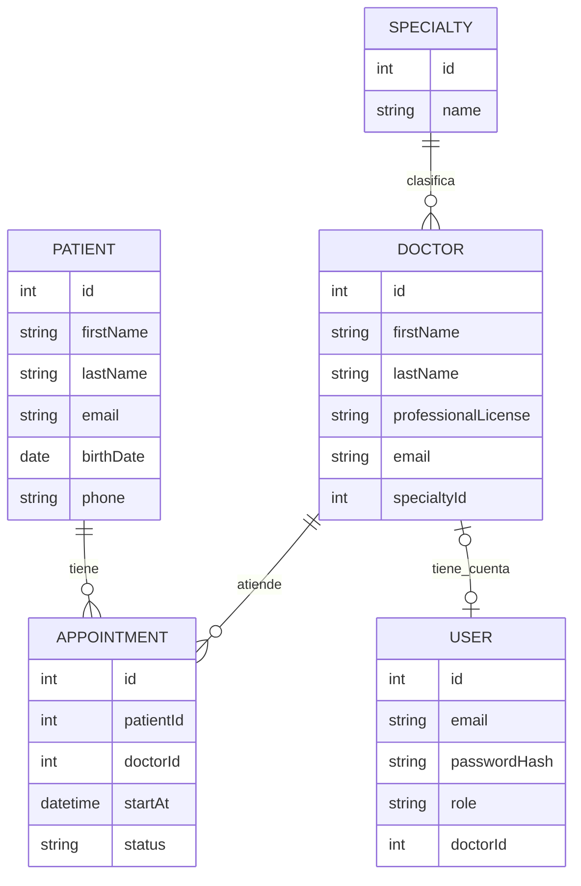

# Modelo Entidad-Relación (MER)

<!--
DOCUMENTO: docs/03.0_diagram-er.md

FUNCIÓN: Documentar el diseño conceptual de la base de datos mediante un modelo entidad-relación.

IMPORTANCIA: Visualizar entidades, atributos, relaciones y cardinalidades antes de diseñar el modelo relacional.

FUENTES: Requerimientos, reglas de negocio y documento de entidades y atributos.

METODOLOGÍA: Preparación, identificación de relaciones, definición de cardinalidades, representación y validación.

IMPORTANTE: En esta etapa no definimos tablas físicas, PK ni FK definitivas.

REGLA: Toda entidad y relación debe estar justificada por las necesidades y reglas del negocio.
-->

## Conceptos fundamentales

- **Entidad:** elemento del negocio que necesita representarse.
- **Atributo:** característica que describe una entidad.
- **Relación:** asociación entre dos o más entidades.
- **Cardinalidad:** cantidad máxima de instancias que pueden relacionarse.
- **Participación:** indica la cantidad mínima de instancias que deben participar en una relación.
- **Identificador:** atributo o conjunto de atributos que distingue una instancia.
- **Entidad asociativa:** representa una asociación entre entidades y puede incorporar atributos propios.
- **Entidad dependiente:** su existencia o identificación depende de otra entidad.

## 1. Preparación del modelo

<!-- Reunir y revisar la información antes de construir el diagrama. -->

**Fuentes:**

- `00.0_requirements.md`
- `01.0_business-rules.md`
- `02.0_entities-and-attributes.md`
- Procesos y relaciones confirmadas del negocio.

### 1.1 Entidades que formarán parte del modelo

| ID | Entidad | Descripción | Documento de origen |
|---|---|---|---|
| ENT-001 | Patient | Representa a las personas que reciben atención y pueden tener citas registradas en la clínica. | 02.0_entities-and-attributes.md |
| ENT-002 | Doctor | Representa a los profesionales médicos que atienden pacientes y tienen una especialidad asignada. | 02.0_entities-and-attributes.md |
| ENT-003 | Specialty | Representa las especialidades médicas disponibles en la clínica y permite clasificar a los médicos. | 02.0_entities-and-attributes.md |
| ENT-004 | Appointment | Representa una cita programada entre un paciente y un médico, incluyendo su fecha de inicio y estado. | 02.0_entities-and-attributes.md |
| ENT-005 | User | Representa las cuentas que permiten autenticarse y acceder a las funciones autorizadas según su rol. | 02.0_entities-and-attributes.md |

### 1.2 Consideraciones del modelo

El modelo conceptual contempla cinco entidades identificadas durante el análisis de requerimientos, reglas de negocio y atributos.

Se establecen las siguientes consideraciones:

1. **Patient:** representa a cada paciente registrado en la clínica. Puede existir sin tener citas registradas.
2. **Doctor:** representa a cada médico registrado. Debe estar asociado obligatoriamente a una especialidad existente.
3. **Specialty:** representa el catálogo de especialidades. Una especialidad puede existir aunque todavía no tenga médicos asociados.
4. **Appointment:** representa la asociación entre un paciente y un médico en una fecha y hora determinadas. Tiene atributos propios y se considera una entidad asociativa.
5. **User:** representa las cuentas de acceso al sistema. Su relación con Doctor depende del rol asignado a la cuenta.

**Decisiones conceptuales importantes:**

- Todas las entidades cuentan con un atributo `id` como identificador candidato.
- Los identificadores naturales, como el correo del paciente, la cédula profesional y el nombre de especialidad, se mantienen como atributos con restricciones de unicidad.
- Appointment representa la asociación entre Patient y Doctor. No se crea una relación directa entre ambas entidades.
- Cada cita tiene una duración fija de 30 minutos. La hora de finalización se obtiene a partir de `startAt`; no se representa como atributo almacenado.
- Los estados de Appointment son `PROGRAMADA`, `COMPLETADA` y `CANCELADA`.
- User se relaciona con Doctor únicamente cuando la cuenta tiene el rol `MEDICO`.
- Los roles `RECEPCIONISTA`, `MEDICO` y `GERENCIA` son valores del atributo `User.role`; no se representan como entidades independientes.
- No se incorporan entidades para pagos, facturación, horarios laborales, expedientes clínicos detallados ni motivos de cancelación, porque están fuera del alcance acordado.

La primera cuenta GERENCIA se provisionará mediante un procedimiento controlado de inicialización. Esta es una decisión técnica documentada en las etapas anteriores y no representa una entidad adicional.

## 2. Identificación de relaciones

<!-- Definir cómo se relacionan las entidades mediante asociaciones reales del negocio, preferentemente expresadas con verbos. -->

**Preguntas de apoyo:**

- ¿Qué entidades se relacionan?
- ¿Qué significa la relación?
- ¿Cuántas instancias pueden participar?
- ¿La relación es obligatoria u opcional?
- ¿Necesita almacenar información propia?
- ¿Qué reglas justifican la relación?

### 2.1 Inventario de relaciones

| ID | Entidad A | Relación (verbo) | Entidad B | Descripción | Regla relacionada |
|---|---|---|---|---|---|
| REL-001 | Specialty | clasifica | Doctor | Una especialidad puede clasificar a varios médicos, pero cada médico pertenece a una sola especialidad. | RN-005, RN-006, RN-025, RN-026 |
| REL-002 | Patient | solicita / tiene | Appointment | Un paciente puede tener varias citas y cada cita pertenece a un solo paciente. | RN-007, RN-011, RN-024 |
| REL-003 | Doctor | atiende | Appointment | Un médico puede atender varias citas y cada cita corresponde a un solo médico. | RN-007, RN-010, RN-018 |
| REL-004 | Doctor | tiene asociada | User | Un médico puede tener como máximo una cuenta de acceso. Una cuenta MEDICO debe estar asociada a un médico existente. | RN-018, RN-027, RN-028, RN-029 |

**Justificación de las relaciones:**

- **REL-001:** permite clasificar médicos por especialidad y realizar consultas y reportes agrupados. La especialidad es obligatoria para cada médico.
- **REL-002:** permite consultar el historial completo de citas de un paciente y recuperar su expediente de atención dentro del alcance definido.
- **REL-003:** permite consultar la agenda de cada médico, programar citas y controlar que no existan traslapes.
- **REL-004:** permite vincular la autenticación de un médico con su registro profesional. La cuenta MEDICO debe corresponder a un Doctor existente; los demás roles no requieren esta asociación.

<!-- Cada relación debe justificarse mediante requerimientos y reglas de negocio. -->

## 3. Definición de cardinalidades y participación

<!-- Determinar cuántas instancias de una entidad pueden asociarse con las de otra. -->

### 3.1 Tipos de cardinalidad

- **Uno a uno (1:1):** una instancia de A puede relacionarse con una de B y viceversa.
- **Uno a muchos (1:N):** una instancia de A puede relacionarse con varias de B, pero cada B puede relacionarse como máximo con una A.
- **Muchos a muchos (N:M):** varias instancias de A pueden relacionarse con varias instancias de B.

### 3.2 Matriz de cardinalidades

| Relación | Entidad A | Entidad B | Cardinalidad | Justificación |
|---|---|---|---|---|
| REL-001 | Specialty | Doctor | 1:N | Una especialidad puede estar asociada con varios médicos. Cada médico debe tener exactamente una especialidad. |
| REL-002 | Patient | Appointment | 1:N | Un paciente puede tener múltiples citas. Cada cita pertenece a un único paciente. |
| REL-003 | Doctor | Appointment | 1:N | Un médico puede tener múltiples citas. Cada cita corresponde a un único médico. |
| REL-004 | Doctor | User | 0..1 : 0..1 (máximo 1:1) | Un médico puede tener cero o una cuenta y una cuenta puede estar asociada a cero o un médico. Si el rol de la cuenta es MEDICO, la asociación con Doctor es obligatoria. |

**Análisis de ambos sentidos:**

- Specialty → Doctor: una especialidad puede clasificar a muchos médicos.
- Doctor → Specialty: cada médico debe pertenecer a una sola especialidad.
- Patient → Appointment: un paciente puede tener varias citas.
- Appointment → Patient: cada cita debe pertenecer a un paciente.
- Doctor → Appointment: un médico puede tener varias citas.
- Appointment → Doctor: cada cita debe corresponder a un médico.
- Doctor → User: un médico puede no tener cuenta o tener una sola cuenta.
- User → Doctor: una cuenta MEDICO debe estar vinculada a un médico; una cuenta de otro rol no tiene esta asociación.

### 3.3 Participación obligatoria u opcional

**Límites de participación:**

- `0..1`: cero o una instancia.
- `1..1`: exactamente una instancia.
- `0..N`: cero o muchas instancias.
- `1..N`: una o muchas instancias.

| Relación | Entidad | Mínimo | Máximo | Participación | Justificación |
|---|---|---:|---:|---|---|
| REL-001 | Specialty | 0 | N | Opcional | Una especialidad puede registrarse antes de tener médicos asociados. |
| REL-001 | Doctor | 1 | 1 | Obligatoria | Cada médico debe estar asociado a una especialidad existente. |
| REL-002 | Patient | 0 | N | Opcional | Un paciente puede registrarse sin tener citas programadas. |
| REL-002 | Appointment | 1 | 1 | Obligatoria | Cada cita debe pertenecer a un paciente existente. |
| REL-003 | Doctor | 0 | N | Opcional | Un médico puede registrarse sin tener citas programadas. |
| REL-003 | Appointment | 1 | 1 | Obligatoria | Cada cita debe estar asociada a un médico existente. |
| REL-004 | Doctor | 0 | 1 | Opcional | Un médico puede existir sin cuenta de acceso o tener como máximo una. |
| REL-004 | User | 0 | 1 | Condicional | Una cuenta MEDICO debe estar asociada a un médico. Las cuentas RECEPCIONISTA y GERENCIA no tienen esta asociación. |

**Aclaración sobre User–Doctor:**

La participación de User en la relación con Doctor es condicional al atributo `role`.

- Si `role = MEDICO`, la cuenta debe tener exactamente un Doctor asociado.
- Si `role = RECEPCIONISTA` o `role = GERENCIA`, la cuenta no debe tener Doctor asociado.

Por lo tanto, la cardinalidad máxima entre Doctor y User es 1:1, pero la participación general es de cero o una instancia en ambos extremos (`0..1`). Para una cuenta MEDICO, la asociación con Doctor es obligatoria; para los demás roles, no existe.

<!-- La participación debe analizarse desde cada extremo de la relación. -->

## 4. Tratamiento de relaciones muchos a muchos

<!-- Identificar las relaciones N:M y analizar su representación conceptual y posterior transformación al modelo relacional. -->

**Ejemplo conceptual:**

Un estudiante puede inscribirse en varios cursos y un curso puede tener varios estudiantes.

La relación puede representarse mediante una entidad asociativa `Enrollment`, especialmente si la inscripción tiene información propia.

Esta entidad podría contener:

- enrollment_date
- status
- grade

### 4.1 Relaciones N:M identificadas

| Relación original | Entidad A | Entidad B | ¿Entidad asociativa conceptual? | Justificación |
|---|---|---|---|---|
| Patient–Doctor | Patient | Doctor | Sí, Appointment | Un paciente puede ser atendido por varios médicos y un médico puede atender a varios pacientes. La asociación necesita almacenar fecha de inicio y estado de cada cita. |

### 4.2 Justificación de entidades asociativas

**Appointment como entidad asociativa**

Appointment representa la asociación entre Patient y Doctor dentro del proceso de atención de la clínica.

Se requiere una entidad independiente porque la asociación tiene información propia:

- `id`: identifica cada cita.
- `patientId`: representa la referencia conceptual al paciente.
- `doctorId`: representa la referencia conceptual al médico.
- `startAt`: indica la fecha y hora de inicio de la cita.
- `status`: representa el estado de la cita.

La duración de cada cita es fija, de 30 minutos, por lo que no es necesario almacenar un atributo adicional para ella. La hora de finalización se obtiene mediante el cálculo de `startAt` más 30 minutos.

La entidad asociativa también permite representar las reglas de disponibilidad, evitar traslapes para médicos y pacientes, y consultar el historial de citas.

No se requiere otra entidad asociativa porque las relaciones restantes son de tipo 1:N o 1:1.

### 4.3 Consideraciones para el modelo relacional

En el modelo relacional posterior:

1. Appointment deberá conservar su propia identidad mediante un identificador sustituto.
2. Deberá representar la asociación con Patient y Doctor mediante referencias a los registros correspondientes.
3. Las referencias deberán garantizar que no existan citas asociadas a pacientes o médicos inexistentes.
4. La relación Patient–Doctor no deberá transformarse en una tabla N:M independiente adicional, porque Appointment ya representa esa asociación y contiene atributos propios.
5. Las restricciones de disponibilidad y traslapes deberán validarse mediante intervalos de tiempo y las reglas de negocio correspondientes.

La relación Doctor–Specialty deberá conservar la obligatoriedad de que cada médico pertenezca a una especialidad existente.

La relación Doctor–User deberá respetar la condición de máximo una cuenta por médico y la obligatoriedad de la asociación para cuentas con rol MEDICO.

<!-- La estructura intermedia definitiva se definirá en el modelo relacional. -->

## 5. Representación de atributos en el modelo

<!-- Definir qué información se mostrará en cada entidad del diagrama. -->

**Elementos principales:**

- Nombre de la entidad.
- Atributos relevantes.
- Identificadores candidatos.
- Atributos que participan en relaciones.

### 5.1 Consideraciones sobre atributos

El modelo representa los atributos identificados en `02.0_entities-and-attributes.md`, respetando sus dominios, obligatoriedad y restricciones.

**Patient**

- `id`: identificador candidato.
- `firstName`: nombre del paciente.
- `lastName`: apellido del paciente.
- `email`: correo electrónico obligatorio y único.
- `birthDate`: fecha de nacimiento.
- `phone`: teléfono opcional.

**Doctor**

- `id`: identificador candidato.
- `firstName`: nombre del médico.
- `lastName`: apellido del médico.
- `professionalLicense`: cédula profesional única.
- `email`: correo electrónico opcional.
- `specialtyId`: referencia conceptual a una especialidad existente.

**Specialty**

- `id`: identificador candidato.
- `name`: nombre de la especialidad, obligatorio y único.

**Appointment**

- `id`: identificador candidato.
- `patientId`: referencia conceptual al paciente.
- `doctorId`: referencia conceptual al médico.
- `startAt`: fecha y hora de inicio.
- `status`: estado de la cita.

**User**

- `id`: identificador candidato.
- `email`: correo electrónico obligatorio y único entre las cuentas.
- `passwordHash`: representación segura de la contraseña.
- `role`: rol de acceso (`RECEPCIONISTA`, `MEDICO` o `GERENCIA`).
- `doctorId`: referencia conceptual al médico, obligatoria para MEDICO y nula para los demás roles.

**Atributos derivados o no almacenados:**

- La hora de finalización de una cita se calcula a partir de `startAt` y la duración fija de 30 minutos.
- La duración de la cita no se almacena porque es una constante definida por las reglas del negocio.
- La cantidad de citas por especialidad y los conteos diarios se obtienen mediante consultas y agregaciones; no son atributos propios de las entidades.
- El nombre completo de una persona puede obtenerse a partir de `firstName` y `lastName`; no se almacena como atributo independiente.

### 5.2 Criterios de representación

- Mostrar los atributos necesarios para comprender el modelo.
- Identificar los atributos candidatos a identificadores.
- Evitar saturar el diagrama con información secundaria.
- Mantener consistencia con `02.0_entities-and-attributes.md`.

En el diagrama se identificarán los atributos `id` como identificadores candidatos y se mostrarán los atributos que participan en las relaciones para facilitar la comprensión de la estructura.

Los atributos `specialtyId`, `patientId` y `doctorId` se mostrarán como referencias conceptuales cuando ayuden a comprender las asociaciones. Su definición como claves foráneas definitivas corresponde al modelo relacional.

<!-- Evitar definir PK y FK definitivas. Su formalización corresponde al modelo relacional. -->

## 6. Construcción del diagrama entidad-relación

<!-- Representar visualmente las entidades, atributos, relaciones y cardinalidades. -->

**Herramientas posibles:**

- Draw.io / diagrams.net.
- Excalidraw.
- Otras herramientas de modelado.

**Notaciones habituales:**

- **Chen:** rectángulos para entidades, rombos para relaciones y óvalos para atributos.
- **Crow's Foot:** símbolos y líneas para representar entidades, cardinalidades y participación.

### 6.1 Herramienta utilizada

Se selecciona **Draw.io / diagrams.net** como herramienta para elaborar el diagrama visual.

Se elige por las siguientes razones:

- Permite representar entidades, atributos y relaciones de forma visual.
- Facilita la representación de cardinalidades y participación mediante notación Crow's Foot.
- Permite reorganizar las entidades para mejorar la legibilidad.
- Permite exportar el diagrama como imagen PNG.
- Facilita conservar el archivo editable para futuras modificaciones.

### 6.2 Notación seleccionada

Se selecciona **Crow's Foot (pata de gallo)**.

Esta notación permite representar claramente las relaciones 1:N y 1:1, así como distinguir la participación obligatoria y opcional.

Se considera apropiada para este proyecto porque:

- Las relaciones pueden interpretarse fácilmente desde ambos extremos.
- Permite identificar las relaciones obligatorias y opcionales.
- Facilita la revisión de las cardinalidades antes de construir el modelo relacional.
- Es compatible conceptualmente con el diseño posterior de tablas y relaciones.

**Convención utilizada:**

- Círculo: participación opcional (cero).
- Barra: participación obligatoria (uno).
- Pata de gallo: múltiples instancias.

### 6.3 Diagrama final

El diagrama deberá representar las cinco entidades y las cuatro relaciones identificadas en este documento.

**Representación lógica de referencia en Mermaid:**

**Nota sobre la relación Doctor–User:** la representación anterior muestra que ambos extremos son opcionales en el modelo general. La condición adicional es que una cuenta con rol MEDICO debe tener un Doctor asociado, mientras que RECEPCIONISTA y GERENCIA no deben tenerlo.

El diagrama visual definitivo deberá construirse en Draw.io con la notación Crow's Foot y reflejar esta condición mediante una nota aclaratoria.

**Ubicación prevista de la imagen final (pendiente de elaboración):**

`docs/03.0_diagram-er.png`

La representación Mermaid anterior sirve como referencia lógica. Cuando se elabore y revise el diagrama visual en Draw.io, se guardará en la ubicación indicada.

## 7. Justificación del modelo

<!-- Explicar las decisiones de diseño; no basta con presentar el diagrama. -->

### 7.1 Justificación de entidades

**Patient**

Se requiere para registrar la información de las personas que reciben atención y relacionarlas con sus citas. Su existencia es independiente de tener citas registradas.

**Doctor**

Representa a los profesionales que atienden a los pacientes. Se mantiene separada de User para distinguir la información profesional de las credenciales de acceso al sistema.

**Specialty**

Permite organizar a los médicos por especialidad y realizar consultas y reportes agrupados. Su existencia independiente permite administrar el catálogo sin depender de que existan médicos asociados.

**Appointment**

Representa cada cita entre un paciente y un médico. Se modela como entidad asociativa porque la relación necesita información propia, como la fecha de inicio y el estado.

**User**

Permite gestionar la autenticación y autorización de los usuarios. Se mantiene separada de Doctor porque no todas las cuentas representan a un profesional médico y porque los datos profesionales no deben mezclarse con las credenciales.

### 7.2 Justificación de relaciones

**Specialty–Doctor**

La relación permite clasificar a los médicos según su especialidad. Cada médico debe tener una especialidad, mientras que una especialidad puede estar asociada con varios médicos.

**Patient–Appointment**

La relación permite recuperar el historial de citas de un paciente y consultar su expediente dentro del alcance del sistema.

**Doctor–Appointment**

La relación permite administrar la agenda de cada médico y controlar la programación de citas.

**Doctor–User**

La relación permite vincular las cuentas de los médicos con su registro profesional. La asociación es opcional para el médico y obligatoria para las cuentas cuyo rol sea MEDICO.

### 7.3 Decisiones de diseño

1. Se mantienen cinco entidades porque representan conceptos independientes del negocio.
2. Appointment se utiliza como entidad asociativa para resolver la relación muchos a muchos que existiría entre pacientes y médicos a través de sus citas.
3. No se crea una relación directa Patient–Doctor porque la asociación está representada por Appointment.
4. Specialty se mantiene como entidad independiente para administrar el catálogo y evitar repetir nombres de especialidades en cada médico.
5. User se mantiene separado de Doctor para distinguir las credenciales y permisos de los datos profesionales.
6. Los roles se representan mediante el atributo `User.role`; no se crean entidades adicionales para cada rol.
7. Se utilizan identificadores sustitutos `id` como identificadores candidatos para las cinco entidades.
8. La duración de las citas es fija y no requiere un atributo adicional.
9. Los datos derivados y los resultados de reportes no se almacenan como atributos de las entidades.
10. No se incorporan entidades financieras, administrativas o clínicas que excedan el alcance acordado.

### 7.4 Limitaciones y asuntos pendientes

El modelo representa únicamente las necesidades funcionales definidas para esta versión del proyecto.

Se mantienen fuera del alcance:

- Pagos y facturación.
- Cálculo de ingresos y rentabilidad financiera.
- Expedientes clínicos detallados.
- Recetas médicas.
- Inventario de medicamentos.
- Administración de horarios laborales.
- Vacaciones y ausencias de médicos.
- Disponibilidad semanal avanzada.
- Motivos específicos de cancelación o inasistencia.
- Registro público de usuarios.
- Auditoría avanzada.

**Consideraciones para etapas posteriores:**

- La integridad de las relaciones deberá formalizarse en el modelo relacional.
- Las restricciones de unicidad deberán definirse para los identificadores naturales correspondientes.
- La relación Doctor–User deberá implementar la condición de máximo una cuenta por médico y la obligatoriedad condicional según el rol.
- Las reglas de traslape de citas deberán implementarse mediante validaciones basadas en intervalos de tiempo.
- La duración fija de 30 minutos deberá mantenerse consistente con las reglas del negocio.
- Las restricciones de autorización deberán implementarse en la capa de aplicación.

No existen relaciones conceptuales pendientes de definición que impidan continuar con el diseño del modelo relacional.

## 8. Trazabilidad del modelo

<!-- Relacionar las entidades y relaciones representadas con sus documentos de origen. -->

| Elemento del modelo | Identificador de origen | Documento relacionado |
|---|---|---|
| Patient | ENT-001 | 02.0_entities-and-attributes.md |
| Doctor | ENT-002 | 02.0_entities-and-attributes.md |
| Specialty | ENT-003 | 02.0_entities-and-attributes.md |
| Appointment | ENT-004 | 02.0_entities-and-attributes.md |
| User | ENT-005 | 02.0_entities-and-attributes.md |
| Specialty–Doctor | REL-001 / RN-005, RN-006 | 01.0_business-rules.md |
| Patient–Appointment | REL-002 / RN-007, RN-011, RN-024 | 01.0_business-rules.md |
| Doctor–Appointment | REL-003 / RN-007, RN-010, RN-018 | 01.0_business-rules.md |
| Doctor–User | REL-004 / RN-018, RN-027, RN-028, RN-029 | 01.0_business-rules.md |
| Duración y atributos de Appointment | RN-008, RN-014, RN-015, RN-016, RN-017 | 01.0_business-rules.md |
| Zona horaria y fechas de Appointment | RN-009, RN-022, RN-023 | 01.0_business-rules.md |
| Reportes por especialidad | RF-011 / RN-020 | 00.0_requirements.md / 01.0_business-rules.md |
| Corte diario de citas | RF-012 / RN-021 | 00.0_requirements.md / 01.0_business-rules.md |
| Administración de médicos y especialidades | RF-003, RF-021, RF-022, RF-023 / RN-025, RN-026 | 00.0_requirements.md / 01.0_business-rules.md |
| Administración de cuentas y roles | RF-024, RF-025 / RN-027, RN-028, RN-029, RN-030, RN-031 | 00.0_requirements.md / 01.0_business-rules.md |

## 9. Validación del modelo

<!-- Comprobar que el diagrama representa correctamente los requerimientos, reglas y entidades identificadas. -->

**Criterios de validación:**

- Todas las entidades están justificadas.
- Las relaciones representan asociaciones reales.
- Las cardinalidades están justificadas.
- Las participaciones están definidas.
- Las relaciones N:M están identificadas.
- Las entidades asociativas están justificadas.
- Los atributos principales están representados.
- No existen contradicciones con las reglas del negocio.
- Existe trazabilidad con los documentos anteriores.
- El diagrama es legible y utiliza una notación consistente.
- El modelo fue revisado por el responsable del proyecto.

| Criterio | Estado |
|---|---|
| Entidades representadas | Validado conceptualmente |
| Relaciones identificadas | Validado conceptualmente |
| Cardinalidades definidas | Validado conceptualmente |
| Participaciones definidas | Validado conceptualmente |
| Relaciones N:M revisadas | Validado conceptualmente |
| Entidades asociativas justificadas | Validado conceptualmente |
| Atributos principales representados | Validado conceptualmente |
| Trazabilidad documentada | Validado conceptualmente |
| Diagrama construido | Pendiente de elaboración visual |
| Modelo validado | Pendiente de revisión final |

**Resultado de la validación conceptual:**

El modelo conceptual contempla las cinco entidades identificadas en el documento de entidades y atributos, así como las cuatro relaciones necesarias para representar los procesos principales de la clínica.

Las cardinalidades y participaciones corresponden a las reglas de negocio acordadas. Se identificó Appointment como entidad asociativa para representar las citas entre pacientes y médicos.

La relación Doctor–User conserva su condición especial: una cuenta MEDICO requiere un médico asociado, mientras que los demás roles no requieren esta asociación.

El modelo mantiene fuera del alcance las entidades y relaciones que no cuentan con justificación funcional en los requerimientos aprobados.

La validación visual definitiva queda pendiente de construir y revisar el diagrama en Draw.io.

## 10. Resultado esperado

<!-- Obtener un modelo conceptual coherente con los requerimientos y reglas del negocio. -->

**Entregables:**

1. Documento de análisis y justificación del modelo entidad-relación.
2. Diagrama entidad-relación en `docs/03.0_diagram-er.png` (pendiente de elaboración visual).

**Documentos relacionados:**

- `00.0_requirements.md`
- `01.0_business-rules.md`
- `02.0_entities-and-attributes.md`
- `04.0_relation-model.dbml`

**Siguiente etapa:** `04.0_relation-model.dbml`.

**Regla metodológica:** El modelo entidad-relación representa la estructura conceptual del negocio. La definición de tablas, claves primarias, claves foráneas y detalles específicos del motor de base de datos corresponde a las etapas posteriores.